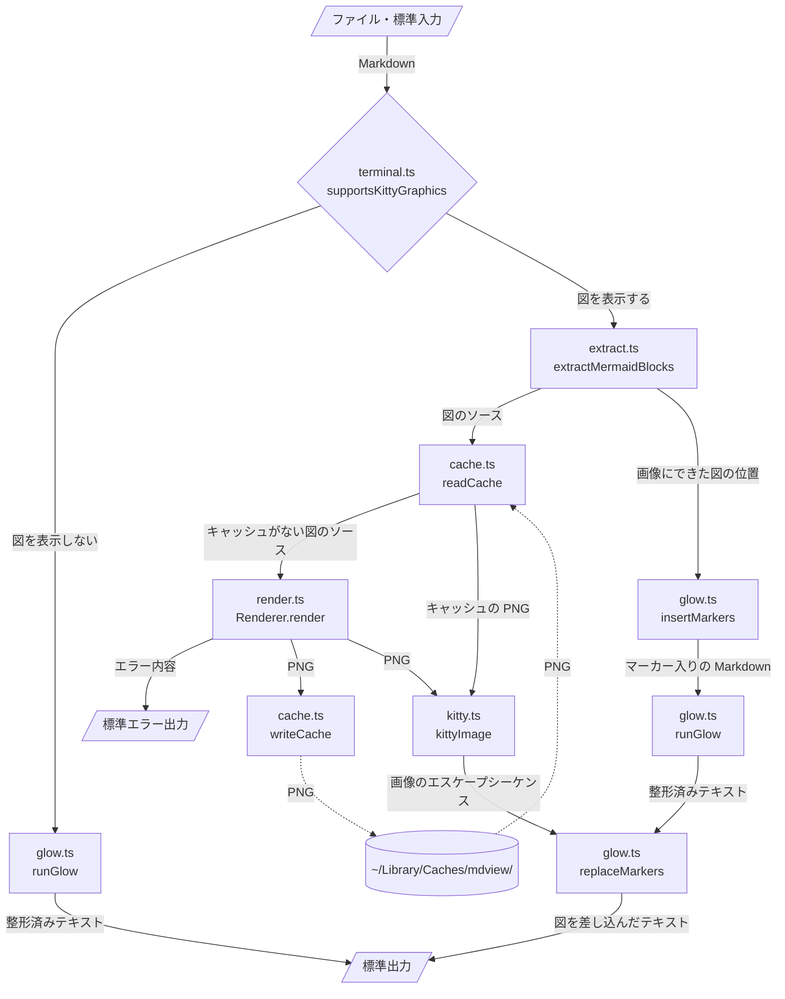
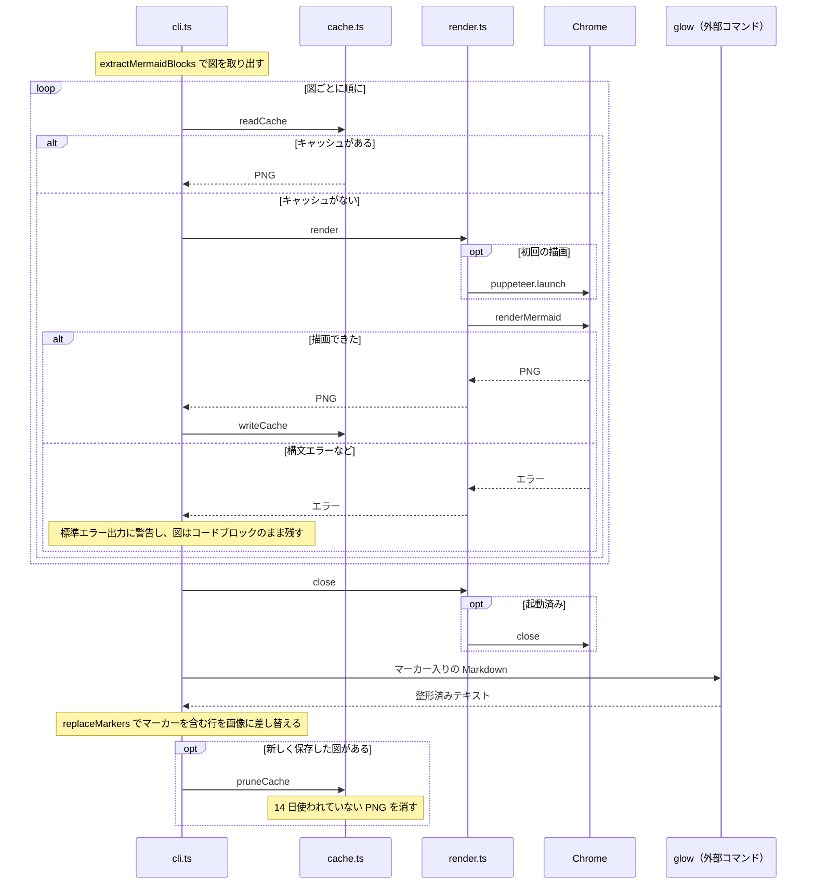

# src

`cli.ts` が全体を制御し、ほかのモジュールを順に呼び出す。モジュール同士は直接呼び合わず、データはすべて `cli.ts` が受け渡す。

## データフロー



描画に失敗した図はマーカーに置き換えず、mermaid のコードブロックのまま glow に渡す。図を表示しない条件は [README](../README.md#図が表示される条件) を参照。

ターミナルの桁数（`-w` を省いたときは `terminal.ts` の `terminalColumns`）は、glow の折り返し幅と、画像を表示する桁数の上限に使う。図の描画には使わず、いつも幅 800px の viewport で描くので、キャッシュのキーにも桁数は入らない。

## 1回の実行で起きること

図を表示する場合の流れ。図は1つずつ順に処理し、Chrome はキャッシュがない図を初めて描画するときに1回だけ起動する。そのため、すべての図がキャッシュ済みなら Chrome は起動しない。新しく描画して保存した図があったときだけ、出力の後で古いキャッシュを消す。



## マーカーの差し込みと差し替え

glow は画像を扱えないので、図をマーカー（図を置く位置の目印の文字列）に置き換えてから glow で整形し、整形後のテキストでマーカーを含む行を画像に差し替える。リストの中に図がある Markdown を例にする。

````markdown
- 構成
  ```mermaid
  flowchart LR
    A --> B
  ```
- 次の項目
````

`insertMarkers` は、mermaid コードブロックをマーカーだけのコードブロックに置き換える。2行目以降には元の行頭（リストの記号は空白に、引用の `>` はそのまま）を付けるので、マーカーはリストの中に残る。マーカーに含まれる `1a2b3c4d` は実行ごとに変わるランダムな値で、本文に書かれた文字列と偶然一致しないようにしている。

````markdown
- 構成
  ```
  MDVIEW1a2b3c4dX0
  ```
- 次の項目
````

マーカーを段落でなくコードブロックにするのは、glow がリスト項目の中の段落を改行せずに前の段落とつなげ、`• 構成MDVIEW1a2b3c4dX0` のように1行にしてしまうため。コードブロックなら、glow の出力でもマーカーが独立した行になる（ANSI エスケープシーケンスは除いて示す）。

```text
  • 構成
    MDVIEW1a2b3c4dX0

  • 次の項目
```

`replaceMarkers` は、ANSI エスケープシーケンスを除いた行にマーカーが含まれていれば、その行全体を画像のエスケープシーケンスに置き換える。マーカーの末尾の数字（`X0` の `0`）が、何番目の図かを表す。

```text
  • 構成
<画像のエスケープシーケンス>

  • 次の項目
```

行全体を置き換えるので、図は左端から表示される。リストや引用の中では、図の行に `•` や `│` が付かない。

## モジュール

| ファイル | 役割 | 主な関数 |
| --- | --- | --- |
| `cli.ts` | 引数の解析と全体の制御。図ごとにキャッシュを引き、なければ描画する | `main` |
| `terminal.ts` | 図を表示できるターミナルかの判定と、桁数の取得 | `supportsKittyGraphics`、`terminalColumns` |
| `extract.ts` | mdast で mermaid コードブロックのソースと位置を取得する | `extractMermaidBlocks` |
| `cache.ts` | 図のソースと描画条件からキーを作り、PNG を読み書きする。14 日使われていない PNG を消す | `cacheKey`、`readCache`、`writeCache`、`pruneCache` |
| `render.ts` | インストール済みの Chrome と mermaid-cli で PNG を描画する | `createRenderer`、`RENDER_OPTIONS` |
| `kitty.ts` | PNG を kitty graphics protocol のエスケープシーケンスにする | `kittyImage`、`pngWidth` |
| `glow.ts` | マーカーの差し込み、glow の呼び出し、マーカーの差し替え | `insertMarkers`、`runGlow`、`replaceMarkers` |

`extract.ts`・`kitty.ts`・`glow.ts` のテストは、同じディレクトリの `*.test.ts` にある（`pnpm test` で実行する）。ほかのモジュールにはまだテストがない。
